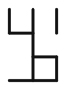

# Cistercian — polyglot numeral playground



In the Middle Ages, Cistercian monks wrote any number from **1 to 9,999 as a single glyph**: a vertical stem with one small mark in each corner. The upper right holds the units, the upper left the tens, the lower right the hundreds and the lower left the thousands. A zero digit leaves its corner empty. The glyph on the right is **1986**:

- a detached outer stroke for units 6;
- a hook joined to the stem for tens 8;
- a closed square for hundreds 9;
- a bottom bar for thousands 1.

This repository defines the glyph geometry precisely, using sources checked against King's *The Ciphers of the Monks*. It then implements the same encoder independently in several languages, and checks every implementation against one shared test suite for all 9,999 numbers.

**▶ Try it: [bigantal.github.io/cistercian](https://bigantal.github.io/cistercian/)**: an interactive explorer drawn with SVG by the TypeScript encoder in this repository.

## Quick start (macOS / Linux)

You need Python 3.10 or later. For the TypeScript implementation and the website, you also need Node.js 20.19 or later with npm.

```bash
git clone https://github.com/bigantal/cistercian.git
cd cistercian
python3 -m venv .venv
.venv/bin/pip install -r requirements-dev.txt
./scripts/test-all.sh
```

`test-all.sh` runs these steps:

- the judge's unit tests;
- a check that the generated SVGs are up to date;
- conformance tests for every implementation;
- the website's tests and build.

It exits with:

- **0** when everything passes;
- **1** on any failure;
- **3** when nothing failed but something could not be tested because a toolchain is missing.

Single steps:

```bash
.venv/bin/python -m pytest                    # judge unit tests
python3 -m judge.runner --language python     # one implementation, all 9,999 numbers
python3 -m judge.runner --all                 # every implementation
python3 -m judge.reference 1986               # reference geometry of one number
```

## Implementations

| Language | Directory | Toolchain | Approach |
|---|---|---|---|
| Python | [implementations/python](implementations/python) | Python ≥ 3.10, standard library only | stroke `Enum`, quadrant dataclass with one affine map |
| TypeScript | [implementations/typescript](implementations/typescript) | Node.js ≥ 20.19, npm | stroke bitmasks, quadrants as point transforms; also powers the website |

The implementations share no code with each other or with the judge. Each one provides:

- an importable `encode` function;
- a thin command-line adapter that follows the [CLI protocol](SPECIFICATION.md#11-cli-protocol-every-implementation);
- a [`manifest.json`](SPECIFICATION.md#12-implementation-manifest) that tells the runner how to build and run it.

To add a language, see [CONTRIBUTING.md](CONTRIBUTING.md).

## The geometry contract

A numeral is a set of line segments on a small integer grid: x from 0 to 2 and y from 0 to 3, with the origin at the top left. The stem runs from (1,0) to (1,3). This is the number 1:

```json
{"segments":[[[1,0],[1,3]],[[1,0],[2,0]]]}
```

Outputs are compared after **normalization**. Every segment is split into unit-length edges, and each edge's endpoints are sorted. So segment order, endpoint direction, and splitting or merging collinear lines don't matter, while any difference in the drawn strokes does. Strokes that don't touch are never joined.

The full rules are in [SPECIFICATION.md](SPECIFICATION.md), along with the [digit chart](docs/digit-chart.svg) for every digit in every corner.

## How it fits together

```text
fixtures/known-values.json ──┐  hand-transcribed ground truth (King 2001 + reviewed examples)
                             ▼
judge/reference.py ──► judge/geometry.py ◄── implementations/*/  (CLI, one process per batch)
  reference encoder      validation +          python, typescript, …
                         normalization
                             ▲
judge/runner.py ─────────────┘  builds, runs and compares every implementation

implementations/typescript/src/encoder.ts ──► web/  (Vite + SVG, imported directly, no copy)
```

More detail: [docs/architecture.md](docs/architecture.md).

## Documentation

- [SPECIFICATION.md](SPECIFICATION.md): convention, grid, digit table, JSON contract, CLI protocol, manifest format
- [docs/references.md](docs/references.md): historical sources, the chosen convention and known variants
- [docs/decisions/](docs/decisions): architecture decision records
- [docs/architecture.md](docs/architecture.md): components and test layers
- [docs/setup.md](docs/setup.md): repository, CI and GitHub Pages setup for maintainers
- [CONTRIBUTING.md](CONTRIBUTING.md): adding a language, reporting a historical error

## Licence

[MIT](LICENSE). Historical sources are cited, not reproduced. The digit chart and all glyphs are generated from this repository's own data.
